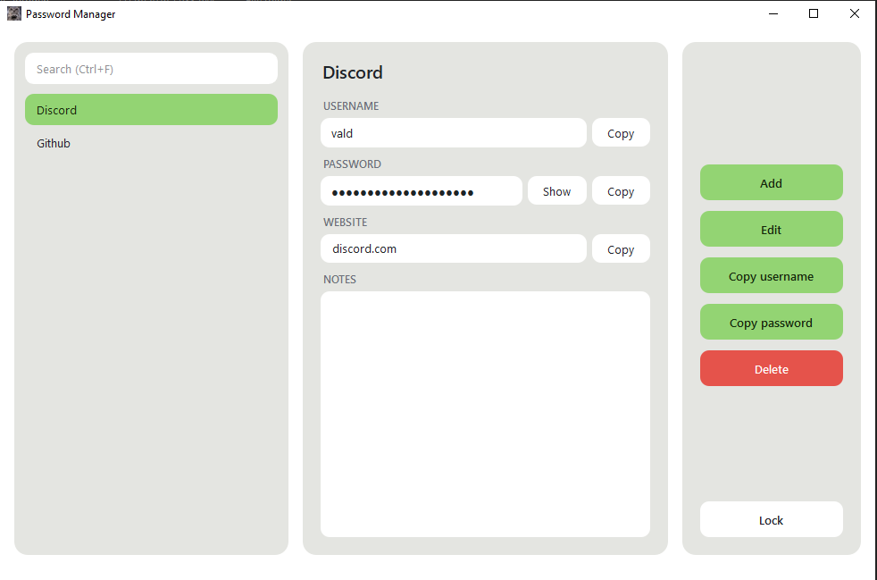
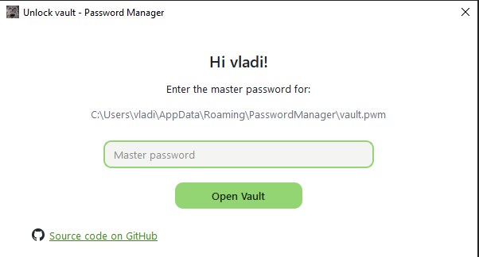
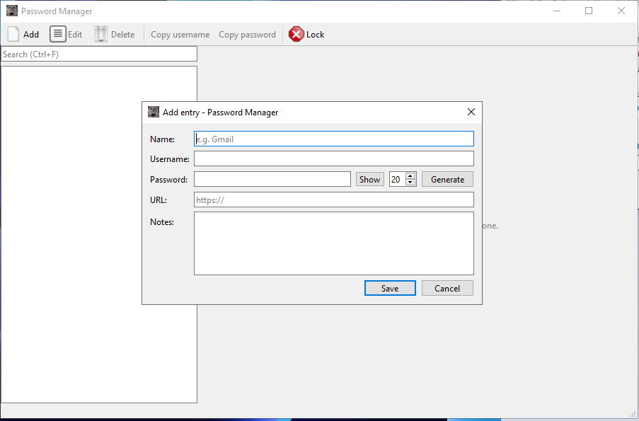
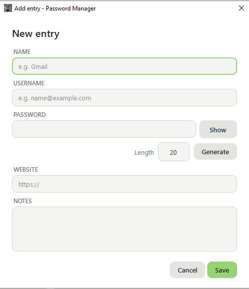

# Password Manager


A local, offline password manager written in C++17. All entries are kept in a single
encrypted file, protected by one master password. It has two interfaces that share the
same core: an interactive command line (CLI) and a Qt 6 desktop application (GUI).



| Unlocking the vault | Adding an entry | Entry with a generated password |
|---|---|---|
|  |  |  |

## Download

A Windows installer is available on the
[Releases](https://github.com/ivlad20/Password-manager/releases) page. It adds a Start menu
shortcut (and optionally a desktop shortcut) and can be removed from *Settings → Apps*.
Uninstalling keeps your vault in `%APPDATA%\PasswordManager`.

The installer is not digitally signed, so Windows may show "Windows protected your PC".
Click *More info → Run anyway* to continue.

## Features

- Master password turned into an encryption key with **Argon2id** (memory-hard, slows down brute force)
- Vault encrypted and authenticated with **XSalsa20-Poly1305** (libsodium `crypto_secretbox`):
  any change to the file is detected and the vault refuses to open
- Entry names are encrypted too: the file reveals nothing except its size
- Atomic saves: the vault is written to a temporary file and then renamed,
  so a crash never leaves a half-written vault
- Random password generator based on libsodium's cryptographically secure RNG
- GUI: search, copy to clipboard (cleared automatically after 30 seconds), show/hide password
- Automatic lock after a period of inactivity (1 minute to 1 hour, or never), when the window
  is minimized and when Windows is locked (Win+L); set in *Settings*
- Change the master password: the vault is re-encrypted with a new salt and key
- Each entry remembers when it was created and last changed, and its last 5 passwords
- Windows installer built with CPack and Inno Setup

## Architecture

The code is split into layers. Each layer only depends on the ones below it, so the
CLI and the GUI are two thin front ends over the same `vault_core` library.

```
  cli/  PasswordManager         gui/  PasswordManagerGui       <- user interfaces
              │                            │
              └─────────────┬──────────────┘
                            ▼
                      core/  Vault                             <- entries, unlock/lock, save
                            │
              ┌─────────────┴──────────────┐
              ▼                            ▼
  storage/  file format,          crypto/  Argon2id,
            serialization                  XSalsa20-Poly1305, RNG
```

| Folder | Contents |
|---|---|
| `src/crypto/` | Key derivation (Argon2id), encryption/decryption, password generator |
| `src/storage/` | Binary file format of the vault and serialization of the entry list |
| `src/core/` | `Vault`: keeps the key and decrypted entries in memory only while unlocked |
| `src/cli/` | Interactive command loop, hidden password input in the terminal |
| `src/gui/` | Qt 6 windows: unlock dialog, main window, add/edit dialog, settings, change master password |
| `tests/` | GoogleTest unit tests for the core and the GUI |
| `resources/` | Application icon |
| `docs/` | Screenshots used in this README |

### Vault file format

All integers are little-endian.

| Field | Size (bytes) | Description |
|---|---|---|
| magic | 4 | `PWMV` |
| version | 4 | format version, currently `2` |
| opslimit | 8 | Argon2id iterations |
| memlimit | 8 | Argon2id memory |
| salt | 16 | random, generated when the vault is created |
| nonce | 24 | random, new on every save |
| ciphertext | rest | encrypted list of entries + 16-byte Poly1305 tag |

Only the ciphertext is secret. The header holds everything needed to derive the key
again from the master password. The key itself is never written to disk.

Decrypted, the ciphertext holds the entry count (u32) and then, for each entry, its
size (u32) followed by tagged fields: `field id u16 | field size u32 | bytes`.

| Id | Field | Value |
|---|---|---|
| 1–5 | name, username, password, url, notes | UTF-8 text |
| 6, 7 | created, last modified | u64, Unix time in seconds (0 = unknown) |
| 8 | favorite | u8, 0 or 1 |
| 9 | tag | UTF-8 text, once per tag |
| 10 | old password | u64 time of the change + the password, newest first, at most 5 |

Unknown field ids are skipped, so newer versions of the app can add fields without
breaking older files. Vaults in format `1` (app versions 0.1.0 and 0.2.0, five
length-prefixed strings per entry) still open and are converted to format `2` on the
next save. Converted entries show their dates as unknown.

## Building

Requirements:
- A C++17 compiler (MSVC on Windows, GCC or Clang on Linux)
- CMake 3.21 or newer
- [vcpkg](https://github.com/microsoft/vcpkg)

The dependencies (libsodium, GoogleTest and Qt 6) are listed in `vcpkg.json`.
vcpkg installs them automatically the first time CMake configures the project.
Qt is compiled from source on the first build, which can take 20 to 60 minutes.
After that it is reused from vcpkg's cache.

```bash
cmake -S . -B build -DCMAKE_TOOLCHAIN_FILE=<path to vcpkg>/scripts/buildsystems/vcpkg.cmake
cmake --build build
```

To build only the CLI, without Qt:

```bash
cmake -S . -B build -DBUILD_GUI=OFF -DCMAKE_TOOLCHAIN_FILE=<path to vcpkg>/scripts/buildsystems/vcpkg.cmake
```

In CLion: *Settings → Build, Execution, Deployment → CMake → CMake options* and add
`-DCMAKE_TOOLCHAIN_FILE=<path to vcpkg>/scripts/buildsystems/vcpkg.cmake`.

### Running the tests

```bash
ctest --test-dir build --output-on-failure
```

The GUI tests open the real windows on Qt's `offscreen` platform, so nothing
appears on screen.

## Making a release

The installer is built from a Release build. It needs
[Inno Setup](https://jrsoftware.org/isinfo.php) (`winget install JRSoftware.InnoSetup`),
with its folder on `PATH`.

1. Update `VERSION` in `project()` in `CMakeLists.txt` (for example `0.2.0`).
2. Build the project with `CMAKE_BUILD_TYPE=Release`.
3. Create the installer from the build folder:
   ```bash
   cd build
   cpack
   ```
   This produces `PasswordManager-<version>-win64.exe`. CPack only packages what is
   already built, so always build first.
4. Test it: install, start it from the Start menu, uninstall.
5. Merge the changes into `master`, then tag that commit and push the tag:
   ```bash
   git tag v0.2.0
   git push origin v0.2.0
   ```
6. On GitHub: *Releases → Draft a new release*, choose the tag, describe the changes
   and attach the installer.

## Usage

### GUI

```bash
PasswordManagerGui [vault file]
```

Without an argument the vault is stored in `%APPDATA%\PasswordManager\vault.pwm`.
The first time, the application asks for a new master password (at least 8 characters)
and creates the vault.

### CLI

```bash
PasswordManager [vault file]
```

Without an argument the vault is `vault.pwm` in the current folder. If it does not
exist yet, the program offers to create it and asks for a new master password twice.
Passwords are not shown while you type them.

| Command | Description |
|---|---|
| `help` | List the commands |
| `list` (or `ls`) | Show all entries |
| `get <name>` | Show one entry, including its password |
| `add` | Add a new entry; leave the password empty to generate one |
| `edit <name>` | Change an entry; press Enter to keep a field unchanged |
| `remove <name>` (or `rm`) | Delete an entry |
| `gen [length]` | Generate a random password (default length 20, between 8 and 128) |
| `passwd` | Change the master password (the vault is re-encrypted with a new salt) |
| `lock` | Lock the vault and ask for the master password again |
| `quit` (or `exit`) | Lock the vault and exit |

Every change is saved to disk immediately.

Example session:

```
> PasswordManager
No vault found at vault.pwm.
Create a new vault? [y/N]: y
New master password:
Repeat master password:
Creating vault (this takes a moment)...
Vault created at vault.pwm.
pm> add
...
pm> list
pm> get Gmail
pm> quit
Bye.
```
